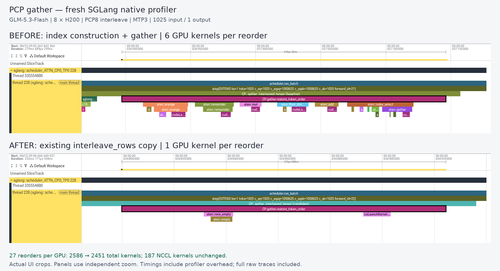

# Interleave PCP ragged-gather profiling evidence

Supporting evidence for SGLang production commit `8a67df6cc24666ec8a648fe8a57b531c9d067d56`. This independent branch contains profiling artifacts only; the code PR changes one framework file.

Download `pcp-perfetto-reviewer.zip`, extract it, and open `pcp-perfetto-native/review.html`. It contains four complete native rank-0 PyTorch-profiler ABBA traces and actual Perfetto screenshots. Search for `CP.gather.restore_token_order` and follow launch correlation flows to the GPU kernels.

Configuration: GLM-5.3-Flash, 8 H200, TP8 / PCP8 interleave / DCP1 / MTP3; automatically resolved BF16 KV, DSA prefill `flashmla_sparse`, decode `fa3`. Prefill CUDA graphs were disabled; decode CUDA graphs remained enabled. Each request has 1025 input tokens and 1 output token. Both arms were warmed and switched in one model process with all-rank acknowledgements.

Each reorder uses 6 kernels before and 1 afterward. All four requests have 27 reorders per rank; full-request kernel counts are 2586/2451/2451/2586 across ABBA, with 187 NCCL kernels per rank throughout. An additional ABBA collection with Python stacks produces the same counts; `count-summary.json` includes all eight ranks from both collections.

The trace files are unmodified native profiler outputs. The ZIP adds the resolved `run-config.json` and acknowledged `capture-summary.json`; trace hashes are in `reviewer-manifest.json`. Original full collection hashes are also included in the ZIP manifest. Eight profiled output token IDs match, which supports these captures but does not replace the separately reported multi-shape correctness checks.

The comparison image combines two actual Perfetto UI crops at independent zoom levels. Profiled durations include instrumentation overhead and are not an unprofiled E2E speedup estimate. Independent repeated latency experiments showed small, variable E2E changes.

`perfetto-validation.json` records the original official Perfetto v59.1 ingestion checks. Native overlap/spill diagnostics are disclosed; CPU-op, GPU-kernel and Python-function import counts reconcile with the raw rank-0 traces.

